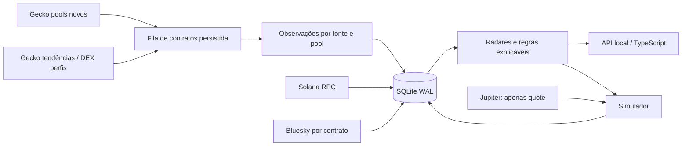

# Arquitetura, banco e operação

## Fluxo



O processo local é uma implantação de desenvolvimento, com frontend e API na mesma origem. Não há CORS aberto. Escritas exigem JSON, Host local e Origin correspondente. A API não tem autenticação multiusuário; deve permanecer em loopback. O frontend escapa strings externas, usa CSP, não carrega scripts de terceiros e não recebe credenciais.

## Esquema e migrações

A inicialização `server.db.connect` é idempotente. Versões ficam em `schema_versions`. A migração 2 preserva posts e troca a chave social para `(URI, contrato)`, permitindo associação de um post a mais de um contrato sem colidir.

| Tabela | Conteúdo e retenção |
|---|---|
| `tokens` | contrato como PK; descoberta inicial, última observação, pool conhecido, atividade e motivo de expiração |
| `snapshots` | JSON de mercado, fonte e horário; unique por contrato/horário/fonte; nunca retrospectivamente preenchido |
| `assessments` | condições, scores, classificação e versão de configuração no instante observado |
| `security` | última auditoria básica por contrato, origem e horário |
| `social` / `social_checks` | posts deduplicados por URI/contrato; cobertura de consultas bem-sucedidas |
| `source_state` / `http_cache` | status, tentativas, backoff, cache e contagem de requisições |
| `jobs` / `job_runs` | lease com proprietário/expiração, rodadas iniciadas/finalizadas e falhas parciais |
| `settings` | configuração persistida com revisão e controle de concorrência |
| `trades` | ledger de simulação, entrada/saída, estratégia, categoria, condição e política congelada |
| `trade_events` | evidência imutável de entrada, cotações observadas e falhas de saída |

Não existe rotina de exclusão do histórico. WAL e `BEGIN IMMEDIATE` protegem escritas. Lease de coleta dura 900 s, com intervalo mínimo persistido. Uma rodada parcial não apaga moedas nem transforma dados antigos em recentes. Orçamento e timeout limitam tráfego; backoff fica no banco. A fila de tokens ativos é reconsultada por antiguidade da última atualização; contratos novos e posições abertas são priorizados dentro do orçamento. O corte de 1.000 contratos na visão geral é explicitado; consulta de detalhe por contrato continua disponível.

## API local

| Método e rota | Comportamento |
|---|---|
| `GET /api/overview` | status das fontes, tokens, parâmetros, narrativas e métricas; nenhuma chave |
| `GET /api/archive?q=...&offset=...` | busca em todo o histórico, inclusive inativos, com páginas de 100 contratos |
| `GET /api/token/:mint` | histórico de observações/avaliações, condições e riscos do contrato |
| `PUT /api/settings` | `{config, revision}` completo; valida intervalos, pesos, tipos e conflitos |
| `POST /api/collect` | `{}`; agenda rodada respeitando lock e intervalo |
| `POST /api/paper/open` | `{mint}`; reavalia condições, aguarda atraso configurado, consulta rotas e registra estimativa se válida |

Não há endpoint de compra real, wallet, envio de transação ou alteração de produção. Erros externos são resumidos sem armazenar URLs privadas, headers ou valores de secrets. O servidor do Python serve apenas `dist/`, sem travessia de diretórios.

## Operação e recuperação

- Variável `EDGE_DB` define o banco. O default `.runtime/edge.sqlite3` é ignorado pelo Git.
- `JUPITER_API_KEY` é opcional e permanece no backend; não habilita assinatura ou execução real.
- Use a API de backup online do SQLite em vez de copiar apenas o arquivo principal enquanto WAL estiver ativo:

```bash
python3 scripts/backup_db.py /caminho/persistente/backup.sqlite3
```

Esse comando cria um arquivo novo, recusa sobrescrita e executa `PRAGMA integrity_check`. Restaurar exige parar o serviço e apontar `EDGE_DB` para uma cópia verificada. Nenhuma recuperação de banco legado foi tentada: os modelos de análise e os dados anteriores ficam no backup separado.

A implementação anterior tem branch de backup, arquivo tar completo (incluindo `.git`) e bundle Git verificado em `/workspace/backups/`. Não houve exclusão de D1 remoto, projetos Vercel, secrets ou wallets. O servidor Worker antigo iniciado durante onboarding deve ser encerrado; suas instruções são substituídas pela inicialização nova no rascunho do ambiente.

## Limitações de produção

SQLite local não é adequado a múltiplas funções efêmeras da Vercel. A publicação exige backend com disco persistente e autenticação, ou implementação D1/Workers/Supabase. Nenhuma migração remota está autorizada implicitamente por esta base. Não publicar até confirmar provedores, coleta real, cadência, monitoramento e recuperação.

Não existe modelo estatístico treinado, validação fora da amostra concluída, detecção de carteiras coordenadas ou cobertura social global. Configurações e políticas congeladas possibilitam pesquisa futura; não estabelecem vantagem.
